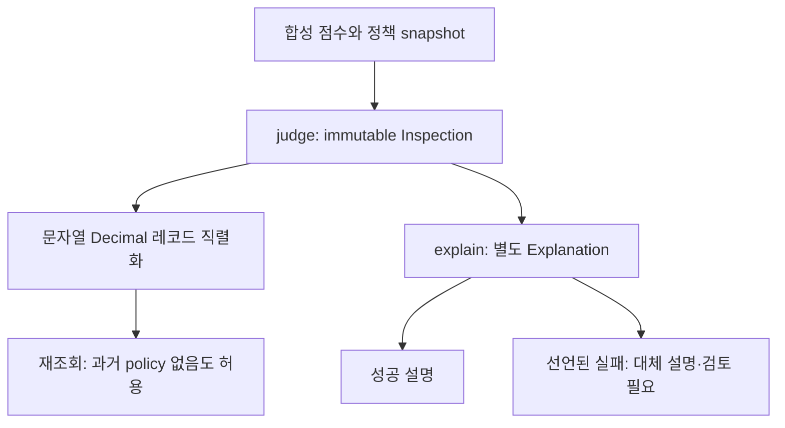

# ANCLA Inspection Contract

**판정·설명 책임 분리 / 정책 snapshot·정밀도·과거 기록 호환**

ANCLA | 제조 외관검사 AI 시스템은 제조 부품의 이상탐지·결함 분류·VLM 설명·사람 검토를 연결하는 프로젝트입니다. 이 저장소는 책임과 데이터 계약을 설명하는 **독립 최소 재현 예제**이며 원본 파이프라인·모델·DB·제조 데이터·테스트를 포함하지 않습니다.

> 공개 범위는 프로젝트명·일반 기능 소개와 독립 예제·문서·테스트 결과입니다. 원본·팀 비공개 자료·미확인 성과 자료는 포함하지 않습니다.

## 바로 보기

| 설계·판단 | 구현 | 테스트 | 실행·한계 |
|---|---|---|---|
| [판정·계보·호환 계약](cases/b-ancla-inspection.md) | [inspection.py](examples/inspection-contract/inspection.py) | [18개 계약 테스트](examples/inspection-contract/test_inspection.py) | [예제 README](examples/inspection-contract/README.md) |

**예제 기술:** Python 3.10+ 표준 라이브러리, frozen dataclass, Decimal, unittest. 외부 패키지·API 키·네트워크가 필요하지 않습니다.

## 예제 아키텍처와 핵심 구현

`judge()`는 당시의 `PolicySnapshot`과 합성 점수로 immutable `Inspection`을 만듭니다. `explain()`은 별도 `Explanation`만 반환해 설명 실패가 판정 필드를 갱신하지 않습니다.



임계값·점수는 float를 거치지 않는 Decimal이고 JSON에는 문자열로 저장합니다. 새 정책이 생겨도 과거 snapshot은 유지합니다. 계보가 없는 과거 레코드는 `None`으로 남기며 현재 설정으로 추정하지 않습니다.

## 실행

저장소 루트에서 예제 폴더로 이동하세요.

```sh
cd examples/inspection-contract
python -B -m unittest -v test_inspection
python -B demo.py
```

데모는 설명 실패 전후 판정 레코드가 같음을 출력합니다. 모든 점수·임계값·버전은 합성 값이며 모델 추론·DB 쓰기를 호출하지 않습니다.

## 검증 결과

분리 후 계약 테스트를 실행해 **18/18건 통과, 실패·skip 0건**을 확인했습니다. [결과·환경·실행 파일 식별](evidence/test-results.md)에 기록했습니다. 설명 성공·실패·빈 응답, JSON 정밀도, 정책 변경, 계보 없는 과거 기록, 부적합 입력을 검사합니다.

## 기여와 자료 범위

예제 개발·자동화된 검증에는 Coding Agent를 활용했습니다. 이 코드로 원본 프로젝트의 지원자·팀원 구현 책임을 재귀속하지 않습니다. 원본 판정·설명 분리의 개인 책임은 미확인 상태이고 공개 허용이 미확인인 팀 자료·개인 기여 상세·실제 검증 집계는 포함하지 않았습니다.

frozen dataclass는 프로그램 계약이며 악의적인 코드에 대한 보안 격리가 아닙니다. SQL 정밀도·migration·DB 트랜잭션·VLM 게이트·비동기 복구·검토 UI는 범위 밖입니다. 과거 호환도 예제에서 명시한 레코드 형식에 한정합니다.

[근거 기준](evidence/README.md) · [공개 범위](docs/publication-scope.md)

저장소 루트의 정적 점검:

```sh
python -B tools/check_repository.py
```

<!-- 공개 권리와 실제 파일을 확인한 PDF가 생기면 이 위치에 링크를 추가한다. 현재 PNG·PDF·임시 URL은 없다. -->
