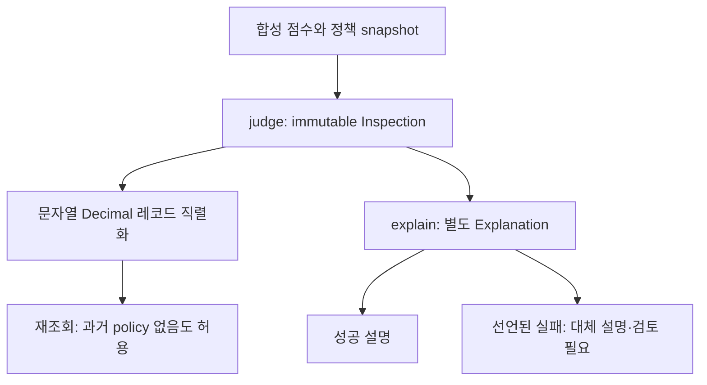

# B. ANCLA — AI Inspection Pipeline & Data Integrity

ANCLA는 제조 부품의 이상탐지·결함 분류·VLM 설명·사람 검토를 연결하는 프로젝트입니다. 아래 구조와 코드는 **독립 예제**이며 원본 파이프라인·DB·추론 결과의 재현이 아닙니다.

## 문제와 판단

설명 실패로 판정을 바꾸거나 현재 설정으로 과거 결과를 해석하면 책임과 이력이 섞입니다. 예제는 판정을 immutable 계약으로 반환하고 설명은 별도 결과로 둡니다. 판정 시점의 정책을 기록하며 과거 계보 부재는 그대로 유지합니다.

## 구현과 재현

- [구현](../examples/inspection-contract/inspection.py): 판정·설명 계약, Decimal snapshot, 레코드 호환.
- [테스트](../examples/inspection-contract/test_inspection.py): 설명 실패 전후 동일성, 정밀도·설정 변경·과거 기록.
- [실행 방법과 범위](../examples/inspection-contract/README.md).

문자열 Decimal은 float 변환 없이 JSON을 왕복하고 새 정책으로 판정해도 기존 snapshot은 유지됩니다. 설명은 판정 필드를 반환하지 않습니다. 합성 테스트18건의 결과는 [로컬 기록](../evidence/test-results.md)에 있습니다.

## 공통계약과 검증 계층

예제의 공통계약은 `PolicySnapshot`, `Inspection`, `Explanation`입니다. 저장 표현과 호출 책임을 작은 모듈에서 함께 검사합니다. 제품에서는 스키마·저장 코드·버전 공급의 책임과 반영 순서를 별도 계약으로 정하고 CPU·격리 DB·GPU 평가를 구분해야 합니다.

이 저장소는 로컬 계약 테스트만 제공하며 DB migration이나 CI 파이프라인을 구현했다고 주장하지 않습니다. 원본 시연 DB 집계·CI 결과는 공개 권리 확인 대상이라 제외합니다.

## 기여·한계

원본 판정·설명 분리의 개인 책임은 미확인 상태이며 팀 구조를 지원자의 독립 구현으로 바꾸지 않습니다. 이 예제는 원본 팀원 작업을 대체하는 근거가 아닙니다. 모델 품질, SQL 정밀도, 비동기 복구, 검토 UI는 검증하지 않습니다.

[보조 검증 기준](../evidence/README.md) · [목록](../README.md)
